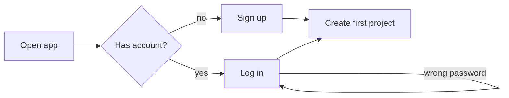

# HeadCanon & Writ — Design Brief v0

Sep 24, 2026 · @Alt

## Purpose

AI coding agents lose track of what the human is trying to build, especially in large projects and over many iterations. This framework captures human intent before the AI acts and keeps it alive afterward. The AI can then check its own short-term decisions against it.

Real project experience showed the gap: prompts alone leave the agent with an imperfect picture of the larger problem. The agent then builds the wrong thing and defends it instead of catching the misunderstanding early.

We target three failure modes:

1. **Substitution:** the agent reinterprets the instructions to fit something closely related that is easier to achieve.
2. **Justification:** the agent reads the evidence so that what was shipped appears to be what was requested.
3. **Erosion:** the agent builds something that fits the current context but overwrites older design goals, without checking with the user first.

The root cause is not settled. Two hypotheses compete, and the design must work under both:

- The agent discovers mid-work that the request isn't feasible as stated, and has no sanctioned way to say so.
- The agent misunderstands the language of the request, and isn't trained to doubt itself and ask for clarification.

Both point to the same remedy: the agent surfaces its interpretation and its obstacles early, where the human sees them. Tagging each caught divergence with its origin (a misread request, a hidden obstacle, or a side effect) lets real usage show which hypothesis dominates. It's one field users can opt out of, trialed on the pet project and removed if it teaches us nothing (decided).

## The prize

Users describe abstract goals, and the AI keeps track of them, maintains them, and uses them to ask for clarification and negotiate roadblocks during implementation.

The work ships as two open-source products that share one intent format (decided):

- **HeadCanon**, the priority now: a Claude Code plugin that keeps the agent aligned during implementation. It lets the user define the canonical layer of intent, including terminology and what they mean when they say X.
- **Writ**: a verification tool that runs on every commit, PR or release. It checks that no earlier goals were overwritten, that new work is documented, and that the documentation doesn't contradict itself. Passing it is the permission to proceed.

Writ's headline output is a report traced to intent: which intentions are verified, which rest on assumptions, and which are untested. This is the visible win; "the AI works better" is too hard to define to be the pitch. Both products are model-agnostic in design, with Claude and Claude Code as v1 scope.

Non-goals:

- **A heavy upfront specification phase.** Existing spec-driven tools are criticized for burying small changes under stories and markdown files. This framework must stay light.
- **Replacing teams' test tooling.** Writ builds on the test frameworks teams already use.
- **Solving every negotiation ahead of time.** Negotiation is a mode the system enters when needed.
- **Owning the user's CLAUDE.md** (proposed). HeadCanon injects its own context instead of editing that file.
- **Claiming guarantees** (proposed). Tests give evidence, not proof, and the framework should say so.

## How to read this brief

Every decision carries a status, borrowing the framework's own idea of certainty. As you review, switch Proposed items to Decided, or comment where something is wrong or missing.

- **Decided:** you stated or confirmed it.
- **Proposed:** Claude suggested it; awaiting your confirmation.
- **Open:** not settled yet.

| Decision | Status |
| --- | --- |
| Three target failure modes: substitution, justification, erosion | Decided |
| Root cause stays an open hypothesis; the design must work under both | Decided |
| Tag each caught divergence with its origin, as an opt-out field; trial it on the pet project and remove it if useless | Decided |
| Two products: HeadCanon (agent alignment during implementation) and Writ (verification per commit, PR or release) | Decided |
| HeadCanon is the priority now | Decided |
| Writ builds on teams' existing test tooling instead of replacing it | Decided |
| HeadCanon's own model is the description framework; Diataxis maybe for user docs later | Decided |
| KAOS obstacle analysis is kept in mind, not adopted now | Decided |
| Requirements form a tree, refined down to binary-measurable leaves | Decided |
| The tree is filled lazily: gaps surface when relevant; deeper details may be marked model assumptions | Decided |
| Human-judgment leaves are allowed (e.g. aesthetics); human approval is enough | Decided |
| Workflow runs requirements → tests → implementation | Decided |
| User journeys are intent records, not tests, kept separate from the tree | Decided |
| Journeys are decision graphs whose steps link many-to-many to requirements at any level | Decided |
| The root canon file's Glossary section defines the user's terms | Decided |
| Undefined or badly defined elements are modeled; the AI maps them with care | Decided |
| Five certainty states: stated, assumed, open, contested, resolved | Decided |
| Journey files: a Mermaid flowchart plus a step-to-requirement table | Proposed |
| Stated items are always verbatim quotes collected from the conversation | Decided |
| Resolved only on the human's explicit agreement; tacit approval never counts | Decided |
| Canon stored as Markdown with front-matter, in a folder tree mirroring the requirement tree | Decided |
| Generated views: a text tree inside the agent, a Mermaid index on GitHub | Decided |
| Negotiation is a triggered mode, not an upfront phase | Decided |
| The agent may work around obstacles alone if intent is preserved | Decided |
| A baseline regression found in the session triggers negotiation | Proposed |
| "Preserved" means every affected journey still plays out as written | Decided |
| Intent history is append-only; the agent proposes, the human approves | Decided |
| Decision records link to intents and get flagged when an intent changes | Decided |
| Intent descriptions go in commit messages in a fixed format, never free-form | Decided |
| Canon files hold the current intent; commit trailers record how and why it changed | Decided |
| Commit format: Conventional Commits header plus required intent trailers | Proposed |
| The agent changes the canon only through create, update and delete requests; a create carries a full node | Decided |
| CUD covers all canon objects; updates are patches; deletes retire; trailers must match the diff; a PR merge is approval | Proposed |
| Intent-traced verification is Writ's headline output, leaning on E2E | Decided |
| Writ checks intent before code; intent takes precedence | Decided |
| Preservation reruns every earlier approved test, not only those linked to changed files | Decided |
| HeadCanon can request acceptance tests from Writ before implementing | Decided |
| Writ stores acceptance tests so they aren't regenerated | Decided |
| Acceptance tests are locked: the agent can run them but not edit them | Proposed |
| A hash of the intent package pins its tests; a changed hash marks them stale | Proposed |
| Writ holds reusable test datasets with ground truth or a validation method | Decided |
| Small datasets are committed to the repo as fixtures in v1; the canon records each source; the user curates ground truth | Decided |
| Separate verifier role; mutation testing | Proposed |
| Weakening a test needs an intent change and human approval; an explicit request in the session counts | Decided |
| Baselines for numeric and open-ended requirements; regressions need approval | Decided |
| HeadCanon also measures in the session; Writ is the gate | Decided |
| Binary baselines, tolerance in the canon, drift tracking, approval as intent change | Decided |
| The model proposes tolerances and the human approves them; repeated runs are left to the team's CI | Decided |
| Writ runs in CI, outside the agent's session | Decided |
| A Writ GitHub Action installs the CLI, runs the stages and reports on PRs | Decided |
| Writ is one CLI (local, CI step, required PR check) reading JUnit XML or CTRF | Proposed |
| Writ reduces redundancy, fits existing ecosystems, and sits a layer above them | Decided |
| Requirements link to files or functions; Writ scopes checks to a commit's changed files | Decided |
| Model checks are non-deterministic; Writ's review report justifies every approval and denial as the audit trail | Decided |
| Links are many-to-many; unlinked changes are flagged; E2E and per-release runs stay unscoped | Proposed |
| The user supplies Writ's model; v1 supports Anthropic models and API keys only | Decided |
| HeadCanon is a Claude Code plugin first; both products model-agnostic in design | Decided |
| SessionStart summary instead of editing CLAUDE.md; Stop hook as the "done" gate | Proposed |
| Later viewing surfaces: a local viewer, then an MCP App | Proposed |
| Paid product: a hosted team layer over the open-source CLI and plugin | Proposed |
| No hosted coding environment; no Claude.ai login, API keys only | Proposed |
| The E2E target is discovered by developing HeadCanon alongside a real pet project | Decided |
| Apache 2.0 for the canon spec, HeadCanon and Writ; the hosted team layer stays proprietary | Proposed |
| Register the HeadCanon trademark; check Writ's registrability first | Proposed |
| A Harmony-based CLA, signed via CLA Assistant, before the first outside contribution | Proposed |
| Clean-room provenance: everything written from scratch for this project | Proposed |

## Core model

Intent is a tree of requirements, refined over time until each leaf can be measured as a yes or a no.

This model, not Diataxis, is HeadCanon's description framework. It borrows from goal-oriented requirements engineering, Shape Up's no-gos, pre-registration and decision records, adapted so it can be filled in gradually.

### Requirement tree (decided)

**The tree is filled lazily.** Nothing has to be defined ahead of time: badly defined elements surface when they become relevant to the work. The deeper in the tree, the more detail the model may decide itself, as long as it contradicts nothing above it and is clearly marked as a model assumption. This avoids the upfront-spec overhead critics found in existing spec-driven tools.

- Top-level requirements are broad categories and may be abstract, such as "new users get productive without help".
- Each is refined into sub-requirements, and those into sub-sub-requirements, as understanding grows.
- A leaf is deep enough when its goal is binary: something is present or absent, or a number is reached or not.
- A node that isn't binary yet is simply not a leaf yet. It shows up as untested, not as a failure.

One caveat (proposed): binary leaves are proxies for the broad goal above them. Each parent keeps its original wording, so a human can judge whether its leaves still capture it. Every leaf passing should not automatically count as the parent being met.

**Human-judgment leaves (decided).** Some goals, like aesthetic differences, can't be tested mechanically. A leaf may then be a yes/no a person answers, and human approval is enough. Proposed interface: approval in the session, recorded verbatim, or a checklist Writ posts on the PR, where GitHub records who ticked each box.

### User journeys (decided)

Journeys are separate from the requirement tree, and among the most important artifacts. They're easy for humans to write, they show how the user envisions the product working, and the current state gets checked against them.

Journeys are recorded as decision graphs that can branch and loop, so a human can follow and check them. Their steps link to requirements at any level of the tree, many-to-many, but the tree isn't built from them. A login step may link to many requirements, and a "no page load over 2 seconds" requirement may link to many steps.

Proposed format: each journey file holds a Mermaid flowchart of the graph plus a table linking step IDs to requirement IDs.



The journey branches on whether the user has an account and loops on a failed login.

| Step | Linked requirements |
| --- | --- |
| S3 Sign up | REQ-1.1 |
| S4 Log in | REQ-2.1, REQ-2.3, REQ-9 (page loads under 2 s) |
| S5 Create first project | REQ-1.2, REQ-1.3, REQ-9 |

### Glossary (decided)

The root canon file has a Glossary section defining the user's own terms: what they mean when they say X, and what X does not mean. When a request uses a term ambiguously, the agent resolves it against the Glossary or asks. Proposed: a term the agent infers enters as assumed until the user confirms it.

```markdown
## Glossary

**Workspace** — a team's shared space for projects. Not a user's personal folder.
**Skip** — defer until later, never remove.
```

### Certainty states (proposed)

Every requirement node and journey step carries one state, so undefined or badly defined elements are modeled rather than hidden.

| State | Meaning | How it's set |
| --- | --- | --- |
| stated | The human's own words | Collected by the agent from the conversation, always verbatim; the human never marks it |
| assumed | The agent's interpretation, not yet confirmed | Agent |
| open | A known unknown | Either |
| contested | Human and agent disagree | Either |
| resolved | Settled, with the resolution recorded | Only on the human's explicit agreement, which can come from the conversation |

Rules (decided): stated items are always verbatim quotes from the conversation. An item becomes resolved only when the human explicitly says something that means agreement; tacit approval never counts. The agent decides which mode applies from the context of the conversation, and these rules are stored as rules it always follows.

The agent is responsible for keeping this map honest. It never fills a gap silently: proceeding on an interpretation creates a visible assumed entry. Open items are resolved when a decision depends on them, and an assumption carrying many decisions is a signal to ask.

### Canon format (decided)

The canon is stored as Markdown files with front-matter, in a folder tree that mirrors the requirement tree. Front-matter holds each node's ID, certainty state, file links and baselines; the body holds the human-readable intent.

Layout (proposed):

```
canon/
├─ README.md                       project purpose + Glossary
├─ REQ-1-onboarding/
│  ├─ README.md                    REQ-1
│  ├─ REQ-1.1-fast-signup.md
│  └─ REQ-1.2-skip-team-setup.md
├─ journeys/
│  └─ JRN-1-first-project.md
└─ decisions/
   └─ DEC-014-defer-team-setup.md
```

A node file (proposed):

```markdown
---
id: REQ-1.2
parent: REQ-1
state: assumed
kind: binary            # binary | numeric | open-ended
steps: [JRN-1/S5]
files: [src/onboarding/setup.ts]
baseline: passing
---

# Team setup can be skipped

## Intent
A new user can reach their first project without creating a team.

## Not this
Removing teams, or hiding the invite flow.

## Assumptions
- "Skip" means deferred until the first invite. (model assumption)
```

This renders without any code of our own:

- Every editor's file explorer shows the requirement tree.
- GitHub shows each folder's README while browsing.
- Every intent change in a PR is a readable Markdown diff, so change requests are reviewable on GitHub from day one.

The CLI generates two views from the source:

- **A text tree for inside the agent.** Plain text renders in Claude Code, the terminal and Codex, so the agent can print it on request.
- **A Mermaid index for GitHub,** colored by certainty state, for PR review and onboarding. Mermaid doesn't render reliably inside the Claude Code tab, so this view is for GitHub and IDE previews.

```
REQ-1    New users get productive without help      stated
├─ REQ-1.1  Sign-up takes under 60 seconds           stated    ✓ verified
├─ REQ-1.2  Team setup can be skipped                assumed   ~ provisional
└─ REQ-1.3  First project starts from a template     open      · untested
```

Limits to design around (proposed): past roughly 15–20 nodes, the Mermaid index shows only the top levels plus one diagram per branch. Generated views can go stale, so the commit hook regenerates them and Writ checks they're current.

## Workflow

Work runs requirements → tests → implementation (decided), so success criteria exist before the code does.

1. Refine requirements until the part being built has binary leaves.
2. Derive tests from those leaves and journeys before implementing, optionally by asking Writ to write the acceptance tests (proposed). Success is defined before results exist, so it can't be reinterpreted afterward.
3. Implement against the tests.
4. Report against the intents: verified, assumed, untested.

### Negotiation mode (decided)

Negotiation is a mode the agent enters when triggered, not a phase done up front. Proposed triggers:

- An obstacle the agent can't get around without changing intent.
- An assumed item becoming decisive for the next step.
- Two intents contradicting each other.
- The agent being unable to write a binary test for a leaf. This is often the earliest sign it doesn't understand what's wanted.
- A baseline regression found during the session. The agent should stop and ask rather than finish and hope.

### Working around obstacles (decided)

The agent may get around an obstacle alone if the intent is preserved. It records the workaround as a decision linked to that intent.

Proposed test for "preserved": every affected journey still plays out as written. If a journey would play out differently, the intent has changed, and negotiation starts.

Proposed rule: stopping to raise an obstacle counts as a successful outcome. The agent must be told this explicitly, or its bias toward action wins.

## Intent history and decisions

Intent never changes silently: history is append-only, the agent proposes changes, and the human approves them (decided).

- Each change records what it supersedes, why, and its origin: human-initiated, or agent-proposed and human-approved.
- Decision records capture short-term implementation choices, each linked to the intent it serves (decided). When an intent changes, its linked decisions are flagged for review. This is the loop where the agent questions its own earlier choices.
- Intent descriptions go in commit messages (decided), so they travel with the code and work in every tool.

### Change requests (decided)

The agent changes the canon only through change requests made of create, update and delete operations; reading is always possible. A create carries a complete node in the canon format.

Proposed refinements:

- The same operations cover every canon object: requirements, journeys, glossary terms and decisions.
- An update carries only the changed fields plus a reason.
- A delete retires a node with a reason instead of erasing it. Retiring its linked tests counts as a test change and needs approval.
- The canon diff in git is the change itself. Commit trailers list the operations, and Writ checks that they match the diff.
- On GitHub, the PR is the change request and a human merging it is the approval. Inside a session, approval comes from the human's explicit words.

### Commit format

Commit messages follow a fixed format, never free-form (decided); the details below are proposed. The header follows Conventional Commits, which many teams already use, and required git trailers carry the intent. The commit-msg hook rejects messages that don't conform.

```
feat(onboarding): defer team setup to first invite

New users reach their first project without creating a team.

Intent: REQ-1.2
Intent-Change: update REQ-1.2
Decision: DEC-014
Approved-By: <human>
```

| Trailer | When | Value |
| --- | --- | --- |
| Intent | Always | One or more requirement or journey IDs, or `none` plus a reason |
| Intent-Change | A canon node was created, updated or deleted | Operation and ID, one trailer per operation |
| Decision | A decision record was added | Decision ID |
| Test-Change | A test was weakened or removed, or its data changed | Test ID and the intent change it cites |
| Approved-By | Any Intent-Change or Test-Change | The approving human |

Two records answer two different questions. The canon files hold the current intent: read them to know what the product should do now. The commit trailers hold the history: read the log to know how and why an intent changed. Squash merges and rebases can collapse or drop trailers, so the files, not the log, are the source of truth for the present.

## Verification: Writ

Writ verifies every commit, PR or release against the canon, using the team's existing test tools rather than replacing them (decided). It leans on end-to-end tests (decided), because vibe coding cares about practical effects.

Writ's checks (decided):

- No earlier goal was overwritten by the change.
- Everything new is documented in the canon.
- The documentation doesn't contradict itself.

### Three stages

Intent is checked before code, because it's what the user wants and takes precedence (decided). Stage 1 should rarely block, since HeadCanon should raise conflicts during the session, but a second check is cheap. Splitting preservation into its own stage is proposed.

1. **Intent check:** compare the change request against the live tree for contradictions, glossary conflicts and missing human approval. The output is an approved package plus its locked acceptance tests.
2. **Delivery:** review the code against the package, then run the package's tests: unit, integration and E2E.
3. **Preservation:** rerun every test from earlier approved packages, not only the tests linked to the files this change touched. This catches erosion that intent checks can't see, where consistent intents still break old behavior through a side effect.

### Acceptance tests written ahead of time (proposed)

HeadCanon can call Writ before implementing, so the acceptance tests come from a different agent and exist before the code:

1. The user approves an intent package in HeadCanon.
2. HeadCanon calls the Writ CLI locally, which runs stage 1 and writes acceptance tests in a separate context.
3. The user skims plain-language descriptions of those tests.
4. The tests are locked; HeadCanon's hooks block the implementing agent from editing them.
5. The agent implements.

Caveats:

- A second agent protects against gaming, not against a shared misreading of the intent. Step 3, the human skim, is the real guard; Writ using a different model from the implementer helps too.
- For tiny changes, this pre-step can be skipped, and both moments can happen in the same PR.

### Stored acceptance tests (decided)

Writ stores the acceptance tests it writes, so they aren't regenerated later. Proposed: each package's tests are pinned to a hash of that package. When the package changes, its hash changes, and its tests are marked stale until they're regenerated and approved again.

### Test data and ground truth (decided)

Some tests need input data: an application that processes data can't be tested without it. Writ holds a collection of datasets, reusable across tests and purposes, each with ground truth or a method for validating results:

- **Exact:** deterministic processing compared to known output.
- **Tolerance or heuristic:** results within a range, or satisfying properties that must always hold.
- **Statistical:** for non-deterministic processing, a pass rate over repeated runs above a threshold.

Details:

- In v1, small datasets are committed to the repo as test fixtures, so the GitHub Action can use them, and the canon records where each dataset comes from as a path or a fetch command (decided). Larger datasets via Git LFS or external storage come later.
- The user curates the ground truth (decided).
- Datasets are versioned and linked to requirements, like tests (proposed).
- Changing a dataset or its ground truth counts as a test change and needs the same approval (proposed).
- Test data is synthetic or anonymized; production personal data is never used (proposed).

### Baselines (decided)

Writ tracks baseline values for numeric requirements, such as performance or cost thresholds, and surfaces any regression for approval. This covers open-ended requirements too: for "round-trip time should be as fast as possible", the baseline becomes the requirement, and it can't get worse without approval.

HeadCanon also measures these during the session; Writ is the gate, not the only tester (decided).

Proposed refinements:

- **Binary requirements use the same mechanism.** Their baseline is "passing", so preservation becomes one rule: anything worse than its baseline needs approval.
- **Tolerance lives in the canon.** The model proposes it and the human approves it through the usual approval process (decided). Repeated runs are left to the team's CI; Writ uses whatever it outputs (decided).
- **Drift is tracked.** Writ compares against the last approved baseline and the original one, and surfaces cumulative drift from many small regressions.
- **Approving a regression is an intent change.** It goes into the append-only history with a reason.
- **Writ's numbers come from CI.** HeadCanon's local measurements are an early warning; Writ takes its numbers from the team's CI; which run counts as authoritative is still open.
- **Baselines live in the repo** and change only through approved commits.

### Where Writ runs

Writ reduces redundancy with existing frameworks, fits into teams' ecosystems, and sits a layer above them (decided). The mechanics below are proposed.

Writ is one CLI that coordinates the team's tools and never executes tests itself. The same CLI runs in three places:

- **Locally,** called by HeadCanon or a developer.
- **As a CI step,** through a Writ GitHub Action that installs the CLI, runs the stages and reports results on the PR (decided). Wrappers for other CI systems follow.
- **As a required status check on PRs.** Merging stays blocked until Writ passes, so it is literally the permission to proceed.

Integration points:

- Writ calls the team's own test commands, configured in the canon.
- It reads results in standard formats: JUnit XML, which nearly every runner produces, or [CTRF](https://ctrf.io), a JSON report format with reporters for Playwright, Jest, Cypress, Go and others.
- Tests link to intent IDs through tags or names, which every major framework supports.
- Baselines live in the repo, so there's no Writ server and no new infrastructure.

| Writ does | Writ leaves to existing tools |
| --- | --- |
| Checks change requests for contradictions, glossary conflicts and approval | Running tests, browsers and assertions |
| Writes acceptance tests in the team's framework and conventions | Test reporting dashboards |
| Measures intent coverage and traceability | Handling flaky tests |
| Tracks baselines and gates regressions for approval | CI orchestration |
| Scopes checks to affected intents | Performance measurement (Writ reads the numbers) |
| Gives the final pass/fail verdict | Code coverage |

The intent check, test writing, code review and contradiction checks need a model, and they can't be made deterministic (decided). Writ's review report justifies every approval and denial, and that report is the audit trail. The product page states plainly that these checks can make mistakes; they're still better than no check.

The user supplies the model and API key. v1 supports only Anthropic models with Anthropic API keys, because each environment imposes changes and the MVP needs one to start from (decided). Running tests and comparing baselines don't need a model.

### Scoped evaluation (decided)

HeadCanon records which files, and which functions inside them, implement each requirement. Writ reads a commit's changed files, maps them to requirements, and loads only those branches of the canon into context. This is an optimization, and it requires requirements to be linked to files or function names.

Proposed refinements:

- Links are many-to-many: a file can serve several requirements, and a requirement can span many files.
- The map comes largely for free. Commits carrying Intent trailers already say which files served which requirement, and a PostToolUse hook can record the rest as the agent edits.
- A changed file with no link is itself a finding: likely new work that isn't documented in the canon.
- Scoping applies only to the expensive model-based checks. Journey E2E tests still run in full, because erosion often arrives indirectly, through a shared file no requirement lists.
- A full, unscoped run per release catches whatever scoping misses.
- Start with file-level links. Function-level links are language-specific and break on renames, so they come later.

### Traceability (proposed)

- Every test carries the ID of the leaf requirement or journey step it verifies.
- E2E tests are the default for journey-level intent; lower-level tests only where a leaf is internal.
- The report measures intent coverage, not code coverage. Each intent is verified, provisional (resting on an assumed item), or untested.

### Guarding against failure mode 2 (proposed)

- A commit that weakens or deletes a test must cite an intent change and carry human approval, or it is blocked (decided). An explicit request from the human in the session counts as that approval (decided). HeadCanon can capture it from the user's own message, not the agent's account of it (proposed).
- A verifier role separate from the implementer writes or reviews the tests.
- Mutation testing confirms that intent-derived tests can actually fail.
- Inside the session, HeadCanon checks the agent's "done" claim against the intent report before it can stop.

### How we describe the benefit (proposed)

The framework shows which intentions are verified. It does not guarantee the product works, and a framework built against overclaiming shouldn't claim that.

## Architecture

Two products sit on one shared canon format, so both stay model-agnostic while v1 targets Claude Code. The two-product split is decided; the layering below is proposed.

1. **Shared canon:** the intent file format, including the glossary, and a small CLI that checks state, generates summaries and renders the tree views. It works with any agent, or none.
2. **HeadCanon:** a Claude Code plugin of skills, hooks and a verifier subagent, calling the CLI. It keeps the agent aligned while it works.
3. **Writ:** a CI tool run on every commit, PR or release. It drives the team's existing test runners and checks the canon itself.

| Framework piece | Where it lives |
| --- | --- |
| Current intent state in every session | HeadCanon: SessionStart hook injecting a generated summary |
| Intent capture, glossary, journeys, negotiation, test derivation | HeadCanon: skills |
| Independent review during the session | HeadCanon: verifier subagent |
| Block silent test weakening in the session | HeadCanon: PreToolUse hook on test files |
| No "done" claim before checking intents | HeadCanon: Stop hook |
| Intent trailers in commits | Shared: git commit-msg hook |
| Goal regression, documentation coverage, contradictions | Writ, in CI |
| Running intent-traced tests | Writ, via the team's own test runner |
| Distribution | HeadCanon: plugin marketplace; Writ: package plus a GitHub Action |
| Intent-to-file map | HeadCanon records it (commit trailers plus a PostToolUse hook); Writ reads it |
| Acceptance tests written ahead of time | HeadCanon skill calling the Writ CLI |
| Baselines | Writ, stored in the repo; HeadCanon also measures locally |
| Text tree and Mermaid index | Shared: CLI render command, run by the commit hook |

Why Writ is separate (proposed): a check run inside the agent's own session isn't independent of it. In CI the agent can't influence the result, and changes made without Claude get checked too.

Constraints to design around:

- The plugin doesn't edit the user's CLAUDE.md. A static file is exactly what drifts, while the SessionStart summary is regenerated every session.
- A Stop hook that blocks can loop forever, so it must check the `stop_hook_active` flag.
- Agents bundled in a plugin can't carry their own hooks, so all hooks live at plugin level.
- Codex has close equivalents: AGENTS.md, skills, hooks, plugins and subagents. A later Codex adapter is mostly a different manifest and hook config pointing at the same CLI.

Reference docs: [Claude Code hooks](https://code.claude.com/docs/en/hooks), [Claude Code plugins reference](https://code.claude.com/docs/en/plugins-reference), [Codex hooks](https://developers.openai.com/codex/hooks).

## Viewing the canon and the paid layer

v1 needs no custom viewer: the canon uses formats that agents and GitHub already render (decided). The later surfaces below are proposed, in order.

1. **v1:** Markdown source, the text tree and the Mermaid index (see Canon format). Review happens in the agent and on GitHub.
2. **Local viewer:** e.g. `headcanon ui`, a browser page reading the canon files: tree, certainty states, pending change requests, history and baselines.
3. **MCP App:** the same UI rendered inside hosts that support [MCP Apps](https://modelcontextprotocol.io/extensions/apps/overview), such as Claude Desktop chat and VS Code. Claude Code doesn't render MCP App UIs yet, per an open issue.
4. **Hosted team layer, the paid product:** Writ as a GitHub App with a dashboard to review intent change requests on PRs, approve baseline regressions, and track intent coverage over time. The CLI and plugin stay open source, an open-core model comparable to Codecov or Chromatic.

Constraints:

- Our products can't offer Claude.ai login or route requests through users' Claude subscriptions. Anthropic requires API keys for third-party products ([Claude Code legal and compliance](https://code.claude.com/docs/en/legal-and-compliance)).
- No hosted coding environment (proposed). Rebuilding coding-agent features competes where we'd be weakest, and API billing would make it pricier than Claude Code itself.
- Before launching anything paid that calls Claude, have a lawyer check Anthropic's commercial terms.

## Licensing and legal (proposed)

The open parts stay genuinely open source, and revenue comes from the hosted team layer, so the business never depends on restricting the open code. None of this is legal advice; a lawyer reviews it before public launch.

| Part | License |
| --- | --- |
| Canon format specification | Apache 2.0, so anyone can implement the standard |
| HeadCanon, Writ CLI, Writ GitHub Action | Apache 2.0: lowest adoption friction, explicit patent grant |
| Hosted team layer | Proprietary, closed source |

Protections that don't depend on the license:

- **Trademarks.** Register HeadCanon. Run a trademark search for Writ before investing in that brand, since it's a common word other software already uses.
- **A CLA before the first outside contribution.** Use the license version of a Harmony agreement, with the outbound option that allows any license, including proprietary, signed in the PR through CLA Assistant. A DCO isn't enough, because it grants no relicensing rights. The rights should pass to a company formed later.
- **Room to tighten later.** With a CLA in place, future versions could move to AGPL or FSL if a competitor becomes a real threat. Released versions keep their license, and tightening invites forks, as Redis showed.
- **Clean-room provenance.** All code, documents and data are written from scratch for this project, starting with this brief, and nothing from any previous employer is used. The git history records when the project started.

Before publishing, a lawyer reviews the license choice, the filled-in CLA and the trademark search, and confirms no prior agreements restrict the project.

## Open questions

None of these block the build; they can be settled along the way.

- [ ] **Authoritative CI:** which CI run's numbers count for baselines. Needs deeper work on CI integration.
- [ ] **Approval interface for judgment leaves:** in-session verbatim approval, a PR checklist, or both?
- [ ] **Naming conventions:** the exact trailer names and the ID format for requirements, journeys, steps, terms and decisions.
- [ ] **Writ trademark:** whether the name can be registered; check before investing in the brand.
- [x] **Datasets:** small fixtures committed to the repo in v1.
- [x] **Divergence origins:** one opt-out field, trialed on the pet project and removed if it isn't useful.
- [x] **E2E target:** discovered by loading HeadCanon into a real pet project.
- [x] **Journeys and the tree:** separate decision graphs, with steps linked to requirements.
- [x] **Human-judgment leaves:** allowed; human approval is enough.
- [x] **Recording approval:** stated items are verbatim; resolved needs explicit agreement.
- [x] **Contradiction checks:** non-deterministic, justified in Writ's review report.
- [x] **Writ's model:** user-supplied; Anthropic models and keys only in v1.
- [x] **Intent file format:** Markdown with front-matter, in a folder tree.
- [x] **Names:** HeadCanon for the agent plugin, Writ for verification.

## First steps in Claude Code

HeadCanon comes first, and it should be built with itself from the first commit (proposed). For the coding agent reading this brief: treat Decided items as stated and Proposed items as assumptions to confirm with the user before building on them, and never upgrade a status yourself. The build order below is proposed.

1. Create the repo and add this brief, exported as Markdown. Add a LICENSE file once the license is confirmed (Apache 2.0 proposed).
2. Turn the decision register into the first canon entries in the new format: Decided items as stated, Proposed as assumed, Open as open.
3. Build the shared canon: the Markdown folder format, the Glossary, journey graphs, a CLI with check, summary and render commands, and the commit-msg hook.
4. Wrap it in a minimal HeadCanon plugin, a SessionStart summary plus one intent-capture skill, and test it locally with `claude --plugin-dir`.
5. Load HeadCanon into the pet project and develop both together; the pet project's needs set the E2E target.
6. Add the verifier subagent, the test-protection hook and the Stop gate once the core holds up.
7. Before accepting outside contributions or announcing publicly, set up the CLA and complete the legal review from the Licensing section.
8. Start Writ once HeadCanon is in use, beginning with the intent check and preservation runs on PRs.
